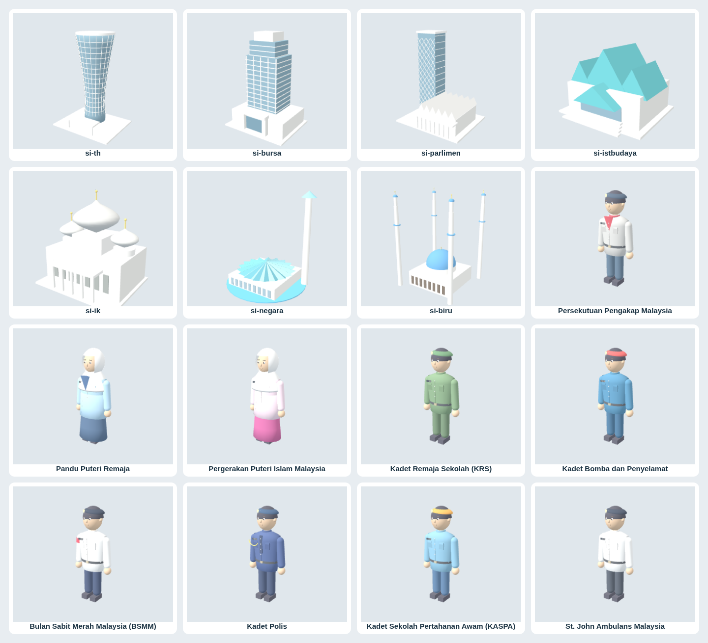

# Avatar dan mercu tanda — v18.35



## Perubahan untuk semakan

Profil anggota memaparkan avatar 3D, nama panggilan, sekolah, kelas dan pakaian semasa. Butang **Pakaian & avatar** membuka Gudang. Pratonton 2D kekal tersedia jika WebGL tidak dapat dimulakan. Susun atur profil turut menyesuaikan skrin telefon.

Avatar 3D yang sama digunakan dalam Gudang dan dunia multiplayer. Bentuk badan diperhalus; mata, kening, hidung, mulut dan telinga ditambah. Uniform mempunyai poket, butang, tanda unit, tali pinggang dan beret apabila tiada penutup kepala lain dipilih. Warna pakaian uniform tetap; aksesori pengguna dikekalkan.

Pilihan baharu: Pengakap, Pandu Puteri Remaja, Puteri Islam, KRS, TKRS, Kadet Bomba, KASPA dan St. John. BSMM dan Kadet Polis sedia ada turut mendapat butiran uniform. ID pakaian lama, termasuk `ou_pk`, tidak dipadam; pakaian yang telah dibeli masih boleh dipakai. Harga dan mekanisme MD mengikut Gudang sedia ada. Pilihan baharu tidak diberikan atau dibeli secara automatik.

## Liputan bangunan

| Stesen | Perubahan visual |
|---|---|
| Tabung Haji | Menara bulat berpinggang dengan bahagian atas melebar, rusuk menegak dan jalur tingkat |
| Bursa Malaysia | Model awal blok pejabat dan podium; fasad sebenar masih memerlukan pengesahan rujukan |
| Parlimen | Menara berlayar konkrit bersilang dan dewan rendah berbumbung berlipat |
| Istana Budaya | Gugusan bumbung biru kehijauan berlipat |
| Istana Kehakiman | Susunan simetri, kubah bawang dan kolonad |
| Masjid Negara | Model masjid tersendiri dengan bumbung payung berlipat 18 bucu |
| Masjid Zahir, Kapitan Keling, Ubudiah, Sultan Salahuddin, Selat Melaka, Sultan Abu Bakar, Bandaraya Kota Kinabalu, Negeri Seremban | Guna semula model masjid khusus sedia ada pada Stesen Ilmu, menggantikan pavilion seragam |

Label dinaikkan mengikut ketinggian bangunan. Model dikecilkan supaya muat dalam kawasan stesen; titik interaksi dialihkan ke hadapan bangunan. Pemetaan tajuk kuiz dan ID stesen dikekalkan. Model pavilion asal kekal sebagai fallback untuk lapan institusi lain yang belum mempunyai model khusus. Skala, arah dan kedudukan beralih setempat mengikut sistem penempatan permainan sedia ada; ini bukan replika ukur atau peta tapak tepat.

## Had pengesahan rujukan

Semasa pembangunan, permintaan ke laman rasmi KPM, Parlimen, Tabung Haji dan Bursa ditolak oleh polisi rangkaian (`403 Forbidden`). Domain rujukan telah ditambah kepada draf tetapan persekitaran; penyimpanan draf tidak mengaktifkan akses dalam sesi semasa.

Oleh itu, model ini ialah penambahbaikan visual untuk semakan, **belum pengesahan kesetiaan kepada fasad sebenar atau peraturan pakaian rasmi terkini KPM**. Senarai unit dipilih daripada unit sekolah yang lazim; status pendaftaran semasa, warna tepat, variasi pakaian mengikut peringkat dan lencana rasmi perlu disemak dengan KPM serta badan masing-masing. Tanda unit dalam model ialah teks, bukan salinan jata rasmi. Khususnya, model Bursa belum layak dianggap replika bangunan sebenar.

Rujukan yang perlu disemak apabila akses tersedia:

- https://www.moe.gov.my — unit beruniform sekolah dan panduan kokurikulum
- https://www.parlimen.gov.my — kompleks bangunan Parlimen
- https://www.tabunghaji.gov.my — Menara TH Jalan Tun Razak
- https://www.bursamalaysia.com — Exchange Square
- https://www.istanabudaya.gov.my — seni bina Istana Budaya
- Badan beruniform masing-masing — variasi pakaian, warna skaf dan penutup kepala

## Pengesahan tempatan

Jalankan pelayan statik dalam checkout, kemudian:

```sh
python3 -m http.server 8000 --bind 127.0.0.1
python3 tools/tests/avatar_landmarks_smoke.py
```

Ujian memerlukan Python Playwright dan Chromium. Ia menyekat semua permintaan luar supaya tidak menulis ke Firebase produksi. Ia menguji pembinaan 26 gabungan avatar/uniform, kod avatar, animasi keraian, fallback SVG, pratonton tanpa potongan MD, pembelian/pemakaian, kad profil, pautan ke Gudang, susun atur telefon, geometri bangunan, penempatan 14 mercu tanda dalam 22 stesen, label, pemetaan kuiz serta butang skrin penuh. Pembinaan dunia diuji dengan gelung render berterusan dihentikan; render model individu diperiksa secara visual. Multiplayer langsung dan kadar bingkai dunia penuh tidak disahkan.

Pilihan: tetapkan `META_DIDIK_SCREENSHOT` kepada laluan PNG untuk menghasilkan helaian semakan visual model. `META_DIDIK_TEST_URL` dan `CHROMIUM_PATH` boleh menukar URL pelayan serta lokasi Chromium.

Versi aset dan cache service worker dinaikkan kepada 18.35 supaya kemas kini dapat dikesan oleh pemasangan PWA sedia ada.
