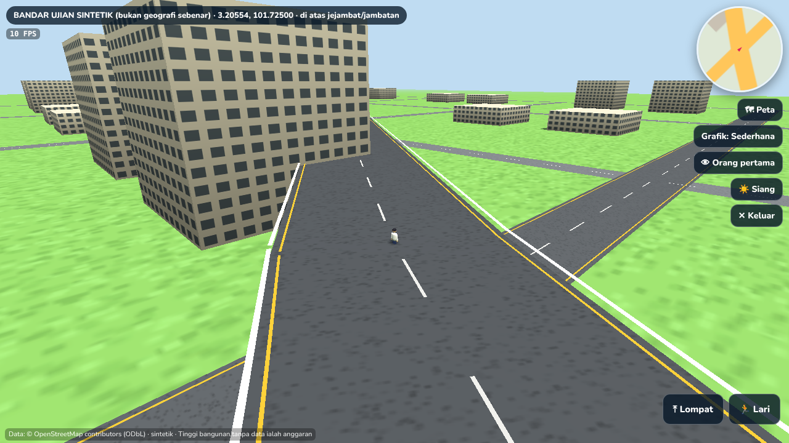
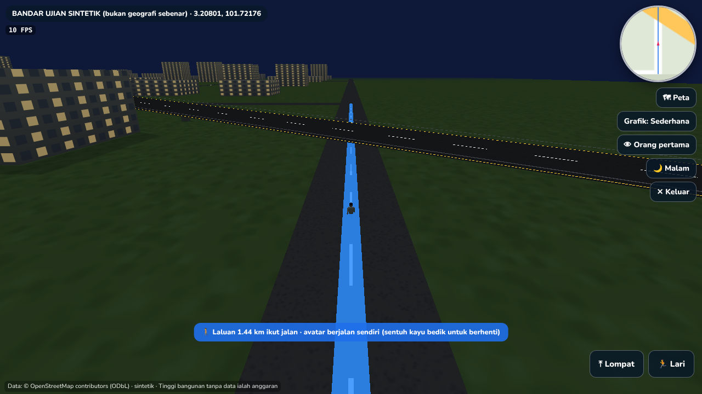
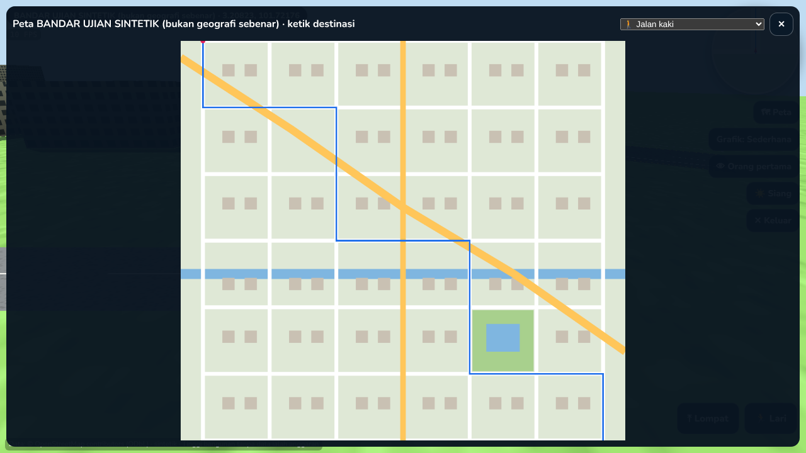
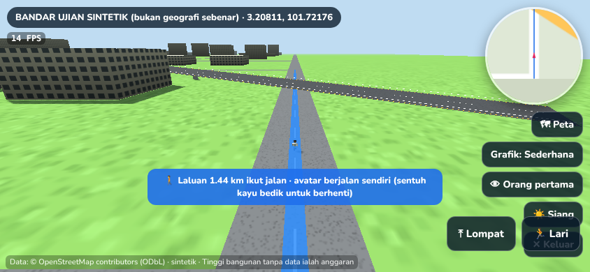
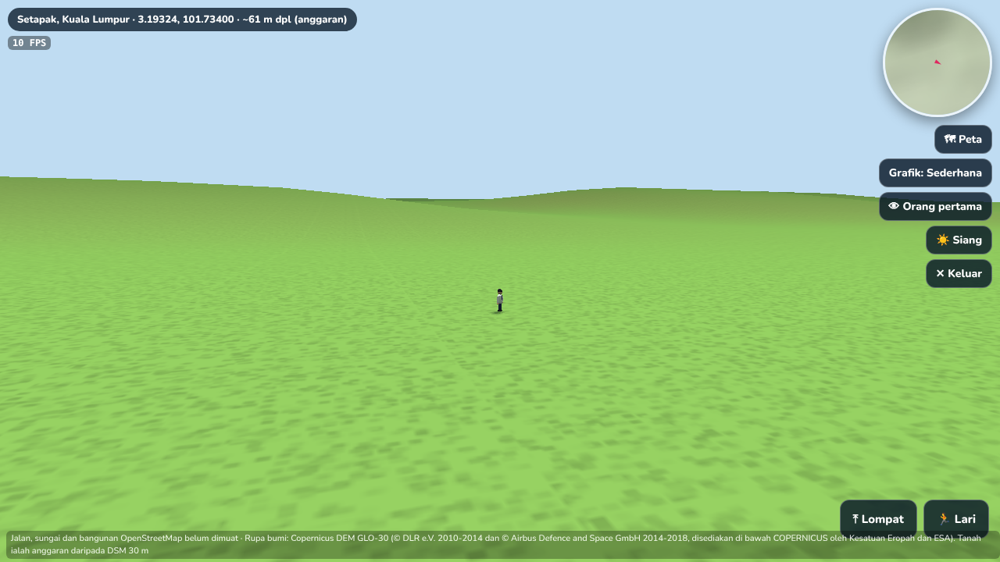
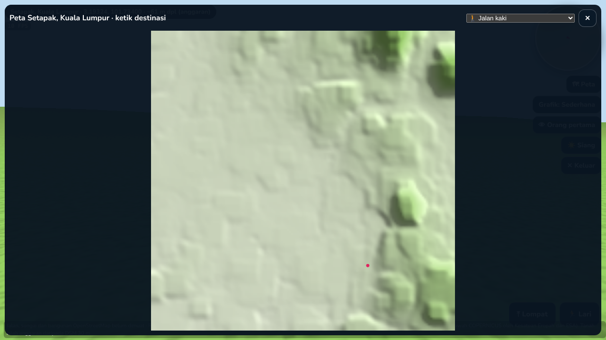
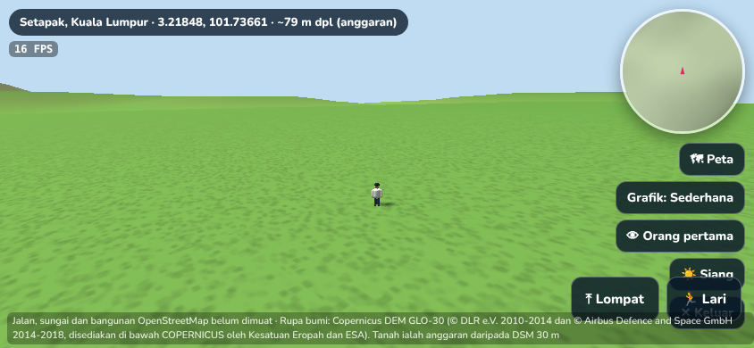
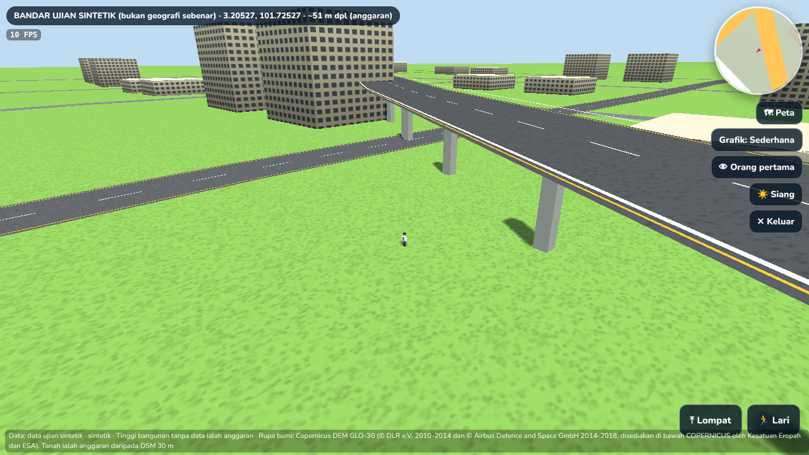

# Fasa 1: Audit dan kawasan perintis data geospatial sebenar (v18.42)

> **Status jujur.** Enjin 3D, pipeline import, Geospatial Validation Engine dan navigasi graf telah dibina dan diuji.
> **Data OpenStreetMap untuk Setapak BELUM dimuat turun**, kerana polisi rangkaian persekitaran pembangunan ini menyekat `overpass-api.de`, `openstreetmap.org`, `download.geofabrik.de` dan `data.gov.my`.
> Tiada jalan, sungai atau bangunan Setapak direka. Dalam aplikasi, kawasan Setapak hanya terbuka selepas data sebenar dijana. Sebelum itu, pemain melihat mesej "Data kawasan perintis belum tersedia".
> Semua tangkapan skrin enjin dalam dokumen ini menggunakan **fixture ujian sintetik** (bandar grid rekaan) yang dilabel jelas.

## 1. Audit repositori

| Perkara | Dapatan |
|---|---|
| Rangka kerja | HTML/CSS/JavaScript tulen tanpa langkah build. Dihoskan di GitHub Pages (metadidik.com) dengan service worker (`sw.js`). |
| Enjin 3D | **Three.js r128** (`three.min.js` tempatan). Dunia utama dalam `dunia.js` (~600 KB, satu fail). Avatar dalam `avatar3d.js` (`AV3.build`, `AV3.anim`). |
| Struktur peta | `meta-geo.json` (sempadan negeri Natural Earth, ~1 km), `meta-dem.bin` (DEM kasar), `meta-jalan.json` (jaringan lebuh raya utama dan jalan persekutuan). Skala 7.5 unit/km, dengan "kanta" Lembah Klang ~4x. |
| Pengguna | Profil `P` dalam localStorage. Firebase **Realtime Database** melalui REST (`FB.req`). Firebase Auth REST (`AUTH`, DELIMa) yang tidak aktif selagi Web API Key belum dimasukkan. |
| Modul dimuat bila perlu | `mod/*.js` melalui `modLoad`/`modCall`: prak, slaid, nelayan, tanahsuci, lid, penaja, perintis. |
| Pembelajaran | Kuiz (bank soalan per subjek), Stesen Ilmu, Menara, Stesen Inovasi guru, simulasi Haji (`mod/tanahsuci.js`), Tempur, Nelayan, situasi akhlak dan sivik, Lifelong ID, penaja. **Tiada yang diubah dalam Fasa 1.** |

**Masalah utama**

1. **Skala dunia utama tidak sesuai untuk jalan bandar.** Pada 7.5 unit/km, seluruh pusat bandar KL (~3.5 km) hanya ~100 unit, jadi jalan kecil dan bangunan sebenar tidak dapat dimuatkan. Ini punca kawasan KL terasa sesak.
2. **Semua dimuat dalam satu adegan.** Seluruh Malaysia dibina sekali (30–35 s di SwiftShader), tanpa penstriman tile.
3. **`dunia.js` dan `app.js` monolitik** (0.6 MB dan 1.9 MB). Sukar diuji, dan cache pecah setiap kali versi ditukar.
4. **Ketepatan data rendah.** Sempadan dan jalan dalam peta utama ialah data skala kecil (Natural Earth dan titik koordinat terpilih), bukan jajaran jalan sebenar.

**Cadangan perubahan minimum (diambil dalam Fasa 1)**

- **Kekalkan Three.js r128.** Tiada penukaran enjin; Babylon.js, Unity WebGL atau Cesium tidak dijustifikasikan dari segi kos dan saiz muat turun telefon.
- **Kawasan perintis sebagai adegan berasingan berskala meter sebenar.** Dimuat bila perlu (`mod/perintis-teras.js`, `mod/perintis.js`), dibuka dari ☰ Menu → 🏙 Setapak. Dunia utama tidak disentuh, dan pemain kembali ke tempat asal selepas keluar.
- **Data bandar disimpan sebagai fail statik JSON yang dijana oleh pipeline, bukan dalam Firebase.** Tiada kos bacaan pangkalan data. Lihat seksyen 4.

## 2. Kajian sumber data (status pengesahan: lihat lajur terakhir)

| # | Sumber | Kandungan | Lesen / syarat (ringkasan) | Kos | Status dalam sesi ini |
|---|---|---|---|---|---|
| 1 | **OpenStreetMap** (openstreetmap.org) | Jalan (dengan `bridge`, `tunnel`, `layer`, `oneway`, `lanes`), bangunan, sungai, POI | **ODbL 1.0**: atribusi "© OpenStreetMap contributors"; pangkalan data terbitan mesti dikongsi di bawah ODbL | Percuma | Dipilih sebagai sumber utama; **akses disekat** |
| 2 | **Overpass API** (overpass-api.de dan cermin) | Ekstrak OSM ikut kotak sempadan | Data ODbL; dasar penggunaan wajar (had kadar, kuota) | Percuma (perkhidmatan sukarela) | Pipeline siap (`tools/geo/perintis.py`); **akses disekat** |
| 3 | Geofabrik (download.geofabrik.de) | Fail `.osm.pbf` Malaysia-Singapura-Brunei, dikemas kini harian | ODbL | Percuma | Alternatif untuk skala negeri (fasa 4); **akses disekat** |
| 4 | MyGDI / MyGDI Explorer (MaCGDI, NRES) | Katalog data geospatial kerajaan | Kebanyakannya perlu permohonan dan perjanjian penggunaan | Bergantung | Perlu permohonan rasmi; belum disemak |
| 5 | JUPEM | Peta topografi, sempadan pentadbiran rasmi | Data rasmi dilesenkan, perlu permohonan dan bayaran | Berbayar | Perlu permohonan; belum disemak |
| 6 | data.gov.my | Set data terbuka (contohnya GTFS yang telah digunakan untuk rel) | Lesen Data Terbuka Kerajaan Malaysia (atribusi) | Percuma | Pernah digunakan untuk rel; **kini disekat** |
| 7 | JKR Malaysia | Rujukan rangkaian jalan persekutuan | Tiada set data vektor terbuka yang diketahui; rujukan sahaja | - | Belum disemak |
| 8 | OpenMapTiles / MapTiler | Vector tiles daripada OSM | Data ODbL; skema OpenMapTiles BSD/CC-BY; hos MapTiler berbayar | Percuma (hos sendiri) / berbayar | Untuk penstriman skala negeri (fasa 4) |
| 9 | DEM: Copernicus GLO-30 / SRTM | Ketinggian muka bumi 30 m | Copernicus: lesen percuma dengan atribusi; SRTM: domain awam | Percuma | Belum dimuat turun; Setapak dirata dahulu |
| 10 | Microsoft Global ML Building Footprints / Google Open Buildings | Footprint bangunan daripada imej satelit | ODbL / CC-BY 4.0 (ikut dataset) | Percuma | Pelengkap jika OSM kurang lengkap; belum disemak |

**Tidak digunakan:** Google Maps dan Google Earth. Terma perkhidmatannya tidak membenarkan data disalin ke dalam permainan.

**Rekod setiap set data:** pipeline merekod sumber, lesen, atribusi, tarikh data OSM (`osm3s.timestamp_osm_base`), masa muat turun dan query sebenar dalam fail data dan fail mentah.

## 3. Pipeline data geospatial (`tools/geo/perintis.py`)

| Langkah | Arahan | Output | Nota |
|---|---|---|---|
| 1. muat | `python3 tools/geo/perintis.py muat setapak` | `data/perintis/setapak.osm.json` | Mentah, tidak di-commit (`.gitignore`). Query Overpass untuk jalan, bangunan, sungai, tasik, taman, POI pendidikan dan awam, lampu isyarat. |
| 2. tukar | `python3 tools/geo/perintis.py tukar setapak` | `data/perintis/setapak.json` | Format padat dalam meter setempat (x timur, z selatan). Lihat ciri di bawah. |
| 3. sahkan | `python3 tools/geo/perintis.py sahkan setapak` | `docs/geo/laporan-validasi-setapak.{json,md}` | Laporan Geospatial Validation Engine. |

Ciri langkah **tukar**:
- ID nod OSM dikekalkan, jadi simpang hanya wujud jika nod dikongsi.
- Atribut `bridge`, `tunnel`, `layer`, `oneway`, `lanes` dan `width` dikekalkan.
- Tinggi bangunan diambil daripada `height` atau `building:levels × 3.2 m`. Jika tiada, tinggi dilabel **`anggar: 1`** (anggaran 2 tingkat), bukan fakta.

Kotak sempadan Setapak: 3.185–3.225°U, 101.705–101.745°T, kira-kira 4.4 × 4.4 km (Wangsa Maju, Danau Kota, Taman Melati, Sungai Gombak/Setapak).

Untuk menjalankan semuanya sekali: `python3 tools/geo/perintis.py semua setapak`.

## 4. Geospatial Validation Engine (`tools/geo/validasi.py`)

Enjin ini **melapor sahaja**; tiada koordinat diubah atau diagak. Setiap isu mempunyai kod, tahap, punca (dataset / rendering / sah), lat/lon WGS84 dan ID OSM.

| Kod | Semakan |
|---|---|
| V1 | Jalan merentas sungai atau tasik tanpa `bridge`/`tunnel` (sungai `culvert` dikira sah) |
| V2 | Jalan menembusi poligon bangunan (kecuali terowong dan aras berbeza) |
| V3 | Geometri jalan berulang (segmen nod dikongsi oleh dua jalan) |
| V4 | Segmen jalan terasing yang tidak bersambung dengan rangkaian |
| V5 | Persilangan tanpa nod. Aras sama → amaran (kemungkinan ralat data). Aras berbeza, jambatan atau terowong → **persimpangan bertingkat sah, tidak disambung** |
| V6 | Konsistensi aras: `bridge` dengan layer ≤ 0, `tunnel` dengan layer ≥ 0, lompatan layer > 1 pada nod dikongsi |
| V7 | Titik di luar sempadan negeri yang dijangka (sempadan `meta-geo.json`, resolusi rendah) |
| V8 | Objek terapung atau tenggelam dalam adegan 3D (`LPT.semakTanah`) |

Keputusan pada fixture sintetik:
- V1 mengesan satu jalan yang sengaja dibina merentas sungai tanpa jambatan.
- V5 mengira 10 persimpangan bertingkat sah (jejambat) dan tidak menyambungnya.
- V8 = 0.

## 5. Prototaip 3D kawasan perintis (`mod/perintis.js`, `mod/perintis-teras.js`)

| Komponen | Pelaksanaan |
|---|---|
| Jalan | Jalur mengikut jajaran sebenar, lebar ikut kelas atau tag `width`, tekstur asfalt, garis tengah putus-putus untuk jalan dua hala, garis tepi kuning untuk jalan utama |
| Jejambat dan jambatan | Ketinggian dek ikut `layer` (6.5 m/aras untuk jejambat, rendah untuk jambatan pendek), cerun di hujung, tiang dan pagar. Terowong tidak dilukis di permukaan (garis putus pada peta). |
| Lampu isyarat | Daripada nod OSM `highway=traffic_signals` |
| Air | Tasik (poligon) dan sungai/longkang (jalur ikut jenis). Pemain tidak boleh berjalan di dalam air kecuali di atas jambatan. |
| Bangunan | Ekstrusi footprint, digabung setiap tile 500 m (1 panggilan lukisan setiap tile). Tekstur tingkap, AO murah (dinding gelap di kaki), tingkap bercahaya pada waktu malam. |
| Taman | Poligon hijau dengan pokok instanced pada kedudukan deterministik dalam poligon |
| Avatar | Avatar 3D sedia ada (`AV3`), animasi jalan, lari dan lompat. Kaki pada permukaan sebenar: tanah atau dek jejambat, dipilih ikut aras semasa. |
| Kamera | Orang ketiga dengan pelicinan, putaran 360°, zum, dan **mengelak bangunan** (raycast). Mod orang pertama juga tersedia. |
| Kawalan | Papan kekunci (WASD, Shift, Space, M, F, Esc); sentuh (kayu bedik dinamik, seret untuk kamera, cubit untuk zum); butang Lompat dan Lari |
| Navigasi | Graf jaringan jalan, **A\*** dengan timbunan binari. Mod jalan kaki (tiada lebuh raya, abaikan sehala) dan mod kenderaan (patuh `oneway`, jalan dipandu sahaja). Ketik peta penuh untuk menetapkan destinasi; avatar berjalan sendiri ikut jalan, **bukan garis lurus**. |
| Peta | Peta mini bulat berputar ikut kamera, dan peta penuh |
| Prestasi | Tiga tetapan grafik (Rendah, Sederhana, Tinggi): resolusi, bayang, antialias, jarak pandang, bilangan pokok. Juga: LOD tile, instancing, penjanaan berperingkat dengan bar kemajuan, jeda apabila di latar belakang, dan pemantau FPS. |
| Atribusi | Paparan sentiasa menunjukkan sumber, lesen dan tarikh data |

## 6. Ujian

| Ujian | Arahan / keadaan | Keputusan |
|---|---|---|
| Enjin validasi dan penukar Overpass | `python3 -m unittest tools/geo/ujian_validasi.py` | **8/8 lulus** |
| Teras perintis | `node --test tools/ujian/perintis-teras.test.js` | **8/8 lulus**. Meliputi: jalan sehala, larangan pejalan kaki di lebuh raya, persimpangan bertingkat tidak bersambung, A* ikut jalan, profil dek, permukaan atas dan bawah jejambat, perlanggaran bangunan, V8. |
| Playwright desktop 1280×720 dan telefon 844×390 (sentuh), fixture sintetik | Lihat butiran di bawah | Lulus, tiada ralat halaman |

Butiran ujian Playwright:
- **Mesej tanpa data:** dipaparkan dengan betul.
- **Pergerakan:** avatar bergerak dengan papan kekunci dan kayu bedik sentuh.
- **Jejambat:** di atas jejambat y = 6.5 m; di bawahnya y = 0.
- **Bangunan:** avatar tidak menembusi bangunan.
- **Navigasi:** laluan A* 1.44 km dihasilkan daripada ketikan peta, dan avatar berjalan sendiri.
- **Kamera:** mod orang pertama berfungsi.
- **Malam:** tingkap bercahaya.

**Ukuran prestasi (SwiftShader, rendering CPU; relatif sahaja, bukan FPS sebenar peranti):**

| Perkara | Nilai |
|---|---|
| Masa bina fixture | ~1.6 s |
| Panggilan lukisan | 29 |
| Segi tiga | 8,860 |
| FPS (tetapan Sederhana) | 10–18 |

Prestasi pada data Setapak sebenar (dijangka ribuan bangunan) **belum diukur**.

**Belum diuji:**
- data OSM sebenar;
- telefon atau GPU sebenar;
- iPhone Safari.

## 7. Kriteria penerimaan: status

| Kriteria | Status |
|---|---|
| Avatar dikawal dengan lancar | ✅ (fixture) |
| Grafik 3D meningkat nyata | ✅ untuk kawasan perintis (asfalt, garisan lorong, jejambat, bayang, malam). Dunia utama tidak diubah. |
| Jajaran jalan perintis berasaskan data sebenar | ⛔ **Belum**, kerana data belum dimuat turun (rangkaian disekat). Pipeline sedia. |
| Tiada jalan palsu merentas air | ✅ dikesan oleh V1. Enjin tidak mencipta jalan atau jambatan; ia hanya menggunakan atribut data. |
| Jambatan dan persimpangan bertingkat dikendalikan betul | ✅ ketinggian dek ikut layer, tidak disambung tanpa nod, diuji |
| Bangunan dan objek di aras tanah logik | ✅ V8 = 0 |
| Peta negeri tidak rawak | ✅ bagi kawasan perintis (koordinat terus daripada data). Penstrukturan negeri → daerah → bandar dirancang untuk fasa 3–4. |
| Sistem sedia ada tidak rosak | ✅ modul berasingan; dunia utama hanya mendapat satu butang Menu |
| Prestasi desktop dan mudah alih | 🟡 diuji dalam emulasi (SwiftShader); belum pada peranti sebenar |
| Atribusi dan penggunaan sah | ✅ ODbL dan atribusi dipaparkan serta direkod |

## 8. Langkah seterusnya

1. **Benarkan akses rangkaian** ke `overpass-api.de` (atau `download.geofabrik.de`) dalam tetapan persekitaran. Kemudian jalankan `python3 tools/geo/perintis.py semua setapak`, semak `docs/geo/laporan-validasi-setapak.md`, dan commit `data/perintis/setapak.json`.
2. **Ukur prestasi pada data sebenar.** Jika bangunan terlalu banyak, kecilkan kotak sempadan atau tambah pemudahan geometri dalam pipeline.
3. **DEM (Copernicus GLO-30)** untuk bukit di Setapak dan Wangsa Maju.
4. **Fasa 2:** profil pemain dan avatar.
5. **Fasa 3:** Kuala Lumpur dan Putrajaya dengan penstriman tile (beberapa kotak sempadan dimuat ikut kedudukan pemain).

## 9. Kos dan risiko

| Perkara | Kos / risiko |
|---|---|
| Data OSM, Overpass dan Geofabrik | Percuma; kewajipan atribusi dan perkongsian ODbL bagi pangkalan data terbitan |
| Overpass awam | Ada had kadar. Untuk skala negeri, gunakan Geofabrik PBF dan pemprosesan luar talian. |
| Hos | Fail JSON statik di GitHub Pages (jangkaan beberapa MB bagi setiap kawasan; perlu dipecah kepada tile untuk skala negeri) |
| Data rasmi (JUPEM, MyGDI) | Memerlukan permohonan, perjanjian dan mungkin bayaran |
| Ketepatan | Bergantung pada kelengkapan OSM di kawasan itu. Laporan validasi menunjukkan jurang dan ralat yang perlu dibaiki pada sumber. |

## Lampiran: tangkapan skrin (FIXTURE SINTETIK, bukan Setapak)

Imej di bawah menggunakan `tools/geo/ujian/fixture-sintetik.json`, iaitu "BANDAR UJIAN SINTETIK (bukan geografi sebenar)". Ia dibina untuk menguji enjin sahaja.

| Imej | Kandungan |
|---|---|
|  | Desktop: avatar dan jejambat |
|  | Desktop: mod malam dengan tingkap bercahaya |
|  | Peta penuh |
|  | Telefon: laluan A* dan auto-jalan |

## Tambahan v18.44: topografi sebenar (Copernicus DEM GLO-30)

`copernicus-dem-30m.s3.amazonaws.com` dibenarkan oleh rangkaian, jadi topografi Setapak kini **data sebenar**.
- **Pipeline:** `python3 tools/geo/dem.py setapak` menghasilkan `data/perintis/setapak-dem.json`.
- **Grid:** 153 × 152 pada ~30 m.
- **Rekod:** sumber, lesen, atribusi dan rujukan EGM2008 direkod dalam fail.
- **Ketinggian tanah:** Copernicus ialah **DSM**. Tinggi tanah dalam permainan ialah **anggaran** (pembukaan morfologi) dan dilabel begitu dalam fail serta paparan.
- **Paparan dalam aplikasi:** tanpa data OSM, kawasan Setapak dibuka dalam **mod topografi sahaja** dengan mesej jelas.
- **Butiran lanjut:** `ROADMAP.md` dan `DEVELOPMENT_LOG.md`.

| Imej | Kandungan |
|---|---|
|  | Setapak: rupa bumi sebenar (DEM), menghadap bukit di timur. Tiada jalan dan bangunan kerana OSM belum dimuat. |
|  | Peta penuh: lorekan bukit daripada DEM sebenar |
|  | Telefon: mod topografi |
|  | **UJIAN ENJIN SAHAJA:** bandar sintetik diletak di atas DEM sebenar untuk menguji jalan, jejambat dan bangunan di atas rupa bumi. Ia bukan geografi sebenar. |
